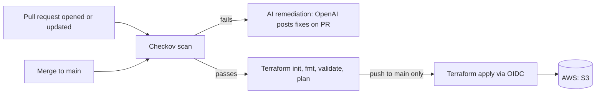

# AI-Powered Terraform CI/CD Pipeline on AWS

A pull-request pipeline where Checkov scans Terraform code for security issues, and AI suggests fixes, before anything reaches AWS.

Every pull request (PR) runs a Checkov security scan. If the scan fails, the findings are sent to the OpenAI API (gpt-4o-mini), and the AI posts suggested Terraform fixes as a comment on the PR. Infrastructure is only deployed (`terraform apply`) after the PR passes the scan and is merged into `main`. GitHub authenticates to AWS with OIDC, so no AWS access keys are stored anywhere.

## Table of Contents

- [Architecture](#architecture)
- [Tech Stack](#tech-stack)
- [Repository Structure](#repository-structure)
- [Prerequisites](#prerequisites)
- [Step-by-Step Build](#step-by-step-build)
- [How the Pipeline Works](#how-the-pipeline-works)
- [Result](#result)
- [Troubleshooting Log](#troubleshooting-log)
- [Lessons Learned](#lessons-learned)
- [Next Improvements](#next-improvements)

## Architecture



Three jobs:

| Job | Trigger | What happens |
| --- | --- | --- |
| Scan | Every PR and every push to `main` | Checkov scans the Terraform. Findings upload to GitHub Security. A failure blocks deploy. |
| AI Remediation | Scan fails on a PR | Checkov findings are sent to OpenAI, and suggested fixes are posted as a PR comment |
| Deploy | Scan passes | `init`, `fmt -check`, `validate`, `plan` on PRs. `apply` only on a push to `main`. |

## Tech Stack

| Tool | Purpose |
| --- | --- |
| Terraform | Infrastructure as Code (IaC): defines AWS resources in code files |
| AWS | Cloud platform where resources are created |
| Amazon S3 | Holds the Terraform remote state (with native S3 locking) and the lab bucket |
| AWS IAM + OIDC | Lets GitHub Actions assume an IAM role with short-lived credentials, no stored keys |
| Checkov | Static security scanner for Terraform |
| OpenAI API (gpt-4o-mini) | AI model that suggests fixes for Checkov findings |
| GitHub Actions | CI/CD (continuous integration / continuous delivery) engine that runs the pipeline |
| GitHub Code Scanning | Displays Checkov results (SARIF) in the repo's Security tab |
| Python | Script that calls the AI and posts the PR comment |
| Git | Version control, feature-branch workflow |

## Repository Structure

```
Open-Ai-Pipeline/
├── .github/
│   └── workflows/
│       └── terraform.yml          # Pipeline definition
├── .vscode/
│   └── settings.json              # Shared editor settings (format on save, rulers)
├── terraform/
│   └── foundation/
│       ├── backend.tf             # S3 remote state
│       ├── versions.tf            # Terraform and provider pins, AWS provider
│       ├── variables.tf           # Region, prefix, environment, tags
│       ├── main.tf                # Lab S3 bucket (intentionally insecure)
│       ├── outputs.tf             # Bucket name and ARN
│       └── .terraform.lock.hcl    # Locks provider versions
├── scripts/
│   └── remediate_ai.py            # AI security remediation
├── requirements.txt               # Python dependencies
├── .gitignore                     # Keeps state, plans, tfvars, and providers out of Git
└── README.md
```

## Prerequisites

- AWS account
- AWS CLI v2 installed and signed in: `aws sts get-caller-identity`
- Terraform 1.10 or newer (required for native S3 state locking): `terraform --version`
- Git and a GitHub account
- OpenAI API account with prepaid credits
- VS Code with the HashiCorp Terraform extension (optional)

## Step-by-Step Build

### Step 1: Set up the repo and `.gitignore`

Create the repo locally and on GitHub, then link them.

```bash
git init -b main
git remote add origin https://github.com/<your-user>/Open-Ai-Pipeline.git
```

Create `.gitignore` before any Terraform files exist, so state and secrets can never be committed:

```gitignore
# Terraform working directory
.terraform/

# State files
*.tfstate
*.tfstate.*

# Plan files
*.tfplan
tfplan

# Variable files with real values
*.tfvars
*.tfvars.json
# Exception: commit the safe template
!terraform.tfvars.example

# Crash logs
crash.log
crash.*.log

# Override files
override.tf
override.tf.json
*_override.tf
*_override.tf.json

# Do NOT ignore .terraform.lock.hcl, commit it

# OS files
.DS_Store
Thumbs.db

# Python
__pycache__/
*.pyc
.env
venv/
```

```bash
git add .gitignore
git commit -m "chore: initial repository setup"
git push -u origin main
```

### Step 2: Create the remote state bucket

Terraform can't store state in a bucket that doesn't exist yet, so the state bucket is created once by hand.

```bash
aws s3api create-bucket --bucket <your-state-bucket> --region us-east-1
aws s3api put-bucket-versioning --bucket <your-state-bucket> \
  --versioning-configuration Status=Enabled
```

### Step 3: Write the Terraform code

All files live in `terraform/foundation/`.

**backend.tf**: stores state in S3, with native S3 locking (no DynamoDB table needed).

```hcl
terraform {
  backend "s3" {
    bucket       = "<your-state-bucket>"
    key          = "foundation/terraform.tfstate"
    region       = "us-east-1"
    encrypt      = true
    use_lockfile = true
  }
}
```

**versions.tf**: pins Terraform and providers, and applies default tags to every resource.

```hcl
terraform {
  required_version = ">= 1.10.0"
  required_providers {
    aws    = { source = "hashicorp/aws", version = "~> 6.0" }
    random = { source = "hashicorp/random", version = "~> 3.6" }
  }
}

provider "aws" {
  region = var.region
  default_tags { tags = var.tags }
}
```

**variables.tf**: reusable inputs.

```hcl
variable "region" {
  type    = string
  default = "us-east-1"
}

variable "prefix" {
  type    = string
  default = "oaip"
}

variable "environment" {
  type    = string
  default = "dev"
}

variable "tags" {
  type = map(string)
  default = {
    Environment = "dev"
    ManagedBy   = "Terraform"
    Project     = "Open-Ai-Pipeline"
  }
}
```

**main.tf**: a lab S3 bucket. The public access block is intentionally turned off so the scanner and the AI have something to catch.

```hcl
resource "random_id" "suffix" {
  byte_length = 4
}

resource "aws_s3_bucket" "lab" {
  bucket = "${var.prefix}-${var.environment}-${random_id.suffix.hex}"
}

# INTENTIONAL VULNERABILITY for the Checkov exercise
resource "aws_s3_bucket_public_access_block" "lab" {
  bucket                  = aws_s3_bucket.lab.id
  block_public_acls       = false
  block_public_policy     = false
  ignore_public_acls      = false
  restrict_public_buckets = false
}
```

**outputs.tf**

```hcl
output "bucket_name" {
  value = aws_s3_bucket.lab.bucket
}

output "bucket_arn" {
  value = aws_s3_bucket.lab.arn
}
```

Check and deploy locally:

```bash
terraform init      # connect to the S3 backend, download providers
terraform fmt       # auto-format
terraform validate  # check for errors without creating anything
terraform plan -out=tfplan
terraform apply tfplan
```

### Step 4: Set up OIDC between GitHub and AWS

OIDC lets the pipeline get short-lived AWS credentials at runtime. AWS trusts GitHub as an identity provider, and an IAM role's trust policy decides which repo is allowed in.

Create the identity provider:

```bash
aws iam create-open-id-connect-provider \
  --url https://token.actions.githubusercontent.com \
  --client-id-list sts.amazonaws.com
```

Create `trust.json` (outside the repo). GitHub may send the `sub` claim with numeric owner and repo IDs, so the policy accepts both formats:

```json
{
  "Version": "2012-10-17",
  "Statement": [{
    "Effect": "Allow",
    "Principal": {
      "Federated": "arn:aws:iam::<ACCOUNT_ID>:oidc-provider/token.actions.githubusercontent.com"
    },
    "Action": "sts:AssumeRoleWithWebIdentity",
    "Condition": {
      "StringEquals": { "token.actions.githubusercontent.com:aud": "sts.amazonaws.com" },
      "StringLike": {
        "token.actions.githubusercontent.com:sub": [
          "repo:<your-user>@<OWNER_ID>/Open-Ai-Pipeline@<REPO_ID>:*",
          "repo:<your-user>/Open-Ai-Pipeline:*"
        ]
      }
    }
  }]
}
```

Create the role and give it permissions:

```bash
aws iam create-role --role-name github-actions-oaip \
  --assume-role-policy-document file://trust.json

aws iam attach-role-policy --role-name github-actions-oaip \
  --policy-arn arn:aws:iam::aws:policy/AmazonS3FullAccess
```

> The `sub` condition is what limits the role to this repo. Without it, any GitHub repo could assume the role.

### Step 5: Set up OpenAI

1. In the OpenAI dashboard, add a small prepaid credit and turn off auto-recharge, so a leaked key can only spend what's loaded.
2. Create a project for this pipeline and a project-scoped API key.

### Step 6: Add GitHub secrets

Repo → Settings → Secrets and variables → Actions → New repository secret

| Secret | Source |
| --- | --- |
| `AWS_ROLE_ARN` | `arn:aws:iam::<ACCOUNT_ID>:role/github-actions-oaip` |
| `OPENAI_API_KEY` | OpenAI dashboard → project → API keys |

`GITHUB_TOKEN` is created automatically by GitHub for every run. No AWS access keys are stored.

### Step 7: Write the pipeline

`.github/workflows/terraform.yml`

```yaml
name: Terraform Pipeline

on:
  push:
    branches: [main]
  pull_request:
    branches: [main]
  workflow_dispatch:

permissions:
  contents: read
  pull-requests: write     # lets the bot comment on the PR
  security-events: write   # uploads Checkov results to GitHub Security
  id-token: write          # requests the OIDC token for AWS

env:
  TF_VERSION: "1.10.5"
  WORKING_DIR: "terraform/foundation"
  AWS_REGION: "us-east-1"
  AI_MODEL: "gpt-4o-mini"

jobs:
  # ── JOB 1: Security Scan ─────────────────────────────
  scan:
    name: Checkov Security Scan
    runs-on: ubuntu-latest
    timeout-minutes: 15
    steps:
      - uses: actions/checkout@v4

      - name: Run Checkov
        uses: bridgecrewio/checkov-action@v12
        with:
          directory: ${{ env.WORKING_DIR }}
          framework: terraform
          output_format: cli,sarif,json
          output_file_path: console,results.sarif,results.json

      - name: Upload SARIF to GitHub Security
        if: always()
        uses: github/codeql-action/upload-sarif@v3
        with:
          sarif_file: results.sarif

      - name: Upload Checkov JSON for AI step
        if: always()
        uses: actions/upload-artifact@v4
        with:
          name: checkov-results
          path: results.json
          if-no-files-found: ignore

  # ── JOB 2: AI Remediation (only when scan fails on a PR) ──
  ai-remediation:
    name: AI Security Remediation
    runs-on: ubuntu-latest
    needs: [scan]
    if: failure() && github.event_name == 'pull_request'
    timeout-minutes: 10
    steps:
      - uses: actions/checkout@v4

      - name: Download Checkov results
        uses: actions/download-artifact@v4
        with:
          name: checkov-results

      - uses: actions/setup-python@v5
        with:
          python-version: "3.12"
          cache: "pip"

      - name: Install dependencies
        run: pip install -r requirements.txt

      - name: Run AI Remediation
        env:
          OPENAI_API_KEY: ${{ secrets.OPENAI_API_KEY }}
          GITHUB_TOKEN: ${{ secrets.GITHUB_TOKEN }}
          PR_NUMBER: ${{ github.event.pull_request.number }}
        run: python scripts/remediate_ai.py

  # ── JOB 3: Terraform Plan / Apply ────────────────────
  deploy:
    name: Terraform Deploy
    runs-on: ubuntu-latest
    needs: [scan]
    timeout-minutes: 30
    steps:
      - uses: actions/checkout@v4

      - uses: hashicorp/setup-terraform@v3
        with:
          terraform_version: ${{ env.TF_VERSION }}

      - name: AWS Login via OIDC
        uses: aws-actions/configure-aws-credentials@v4
        with:
          role-to-assume: ${{ secrets.AWS_ROLE_ARN }}
          aws-region: ${{ env.AWS_REGION }}

      - name: Terraform Init
        working-directory: ${{ env.WORKING_DIR }}
        run: terraform init

      - name: Terraform Format Check
        working-directory: ${{ env.WORKING_DIR }}
        run: terraform fmt -check -recursive

      - name: Terraform Validate
        working-directory: ${{ env.WORKING_DIR }}
        run: terraform validate

      - name: Terraform Plan
        working-directory: ${{ env.WORKING_DIR }}
        run: terraform plan -out=tfplan

      - name: Terraform Apply
        if: github.ref == 'refs/heads/main' && github.event_name == 'push'
        working-directory: ${{ env.WORKING_DIR }}
        run: terraform apply -auto-approve tfplan
```

### Step 8: Write the AI reviewer

`requirements.txt`

```
openai>=1.50.0
requests>=2.32.0
```

`scripts/remediate_ai.py` reads Checkov's real findings, deduplicates them by check ID, asks OpenAI for a fix for each (up to 5), and posts one PR comment.

Key parts:

```python
from openai import OpenAI

client = OpenAI()  # reads OPENAI_API_KEY from the environment

def get_ai_fix(check_id, resource, file_path, guideline):
    prompt = (
        f"Checkov check {check_id} failed on resource '{resource}' in {file_path}.\n"
        f"Guideline: {guideline}\n\n"
        "Give a concise Terraform HCL fix for AWS."
    )
    try:
        resp = client.chat.completions.create(
            model=model,
            messages=[
                {"role": "system", "content": "You are a DevSecOps engineer specializing in Terraform and AWS security. Be concise."},
                {"role": "user", "content": prompt},
            ],
            max_tokens=600,
            temperature=0.1,
            timeout=30,
        )
        return resp.choices[0].message.content
    except Exception as e:
        print(f"OpenAI error for {check_id}: {e}")
        return None
```

The script then posts the result to the PR using the GitHub REST API: `POST https://api.github.com/repos/{repo}/issues/{pr_number}/comments`

### Step 9: Test with a feature branch

```bash
git checkout -b feature/add-pipeline
git add .github scripts requirements.txt
git commit -m "ci: add terraform pipeline with checkov gate and ai remediation"
git push -u origin feature/add-pipeline
```

On GitHub: **Pull requests → New pull request** → base: `main`, compare: `feature/add-pipeline`.

The pipeline runs automatically. The scan fails on the intentional vulnerability, deploy is skipped, and the github-actions bot posts the AI suggestions in the **Conversation** tab. Full findings appear under **Security → Code scanning**.

## How the Pipeline Works

1. A PR is opened against `main`, which triggers the pipeline.
2. **Scan:** Checkov scans `terraform/foundation`. Results go to the log, to GitHub Security (SARIF), and to a JSON artifact.
3. **If the scan fails:** deploy is blocked (`needs: [scan]`). On PRs, the AI job downloads the JSON, sends each unique finding to OpenAI, and posts the suggested fixes as a PR comment.
4. **If the scan passes:** deploy assumes the IAM role through OIDC, then runs `init`, `fmt -check`, `validate`, and `plan`.
5. **After merge to `main`:** the same flow runs on the push, and `terraform apply` deploys the saved plan to AWS.

## Result

Checkov flagged 11 findings on the lab bucket: the four public access block settings that were turned off on purpose, plus general S3 hardening checks (versioning, KMS encryption, access logging, lifecycle configuration, event notifications, cross-region replication).

The AI comment correctly suggested the fix for the public access block:

```hcl
resource "aws_s3_bucket_public_access_block" "lab" {
  bucket                  = aws_s3_bucket.lab.id
  block_public_acls       = true
  ignore_public_acls      = true
  block_public_policy     = true
  restrict_public_buckets = true
}
```

It also got one finding wrong. For `CKV2_AWS_61` (lifecycle configuration), it suggested an S3 logging block in outdated syntax. That's a clear example of why the AI only suggests and a human reviews before merging.

## Troubleshooting Log

Real issues hit while building this project and how they were solved.

| Symptom | Cause | Fix |
| --- | --- | --- |
| `zsh: command not found: code` | VS Code shell command not in PATH | VS Code → Cmd+Shift+P → *Shell Command: Install 'code' command in PATH* |
| `Set-Alias: command not found` | `Set-Alias` is PowerShell; the Mac terminal runs zsh | `alias tf='terraform'`, added to `~/.zshrc` |
| `terraform init`: "initialized in an empty directory" | Ran from `terraform/` instead of `terraform/foundation/` | `cd foundation`, then init |
| `fatal: 'origin' does not appear to be a git repository` | Remote was added with a typo (`orgin`) | `git remote rename orgin origin` |
| `pathspec 'requirements.txt' did not match any files` | File was never created, so `git add` staged nothing | Create the file, then rerun `git add` |
| `gh: command not found` after `pip3 install gh` | The pip package `gh` is unrelated to the GitHub CLI | `pip3 uninstall gh`, then `brew install gh` or use the GitHub website |
| `.gitignore` exception not working | Inline comment on the `!terraform.tfvars.example` line | Move comments to their own line |
| OIDC: `Not authorized to perform sts:AssumeRoleWithWebIdentity` | GitHub sent `sub` with numeric IDs (`owner@id/repo@id`), which didn't match the trust policy | Found the real `sub` in CloudTrail, added it to the trust policy |
| Bedrock: `ThrottlingException: Too many tokens per day` | New AWS account had 0 Bedrock quota for every model; increase request was rejected | Switched the AI step to the OpenAI API |
| AI comment posted but empty ("...and 6 more" only) | Every AI call failed, and the script skipped failed findings silently | Read the job log, fixed the provider |
| AI suggested the wrong fix for `CKV2_AWS_61` | Script sent only the check ID, so the model guessed what it meant | Pass Checkov's `check_name` into the prompt |

## Lessons Learned

- **Pipelines should fail loudly.** An AI step that passed with an empty comment hid the real error.
- **CloudTrail answers OIDC errors.** The rejected event showed the exact `sub` claim GitHub sent, which solved the problem in one step.
- **New cloud accounts often start with zero AI quota.** Both Bedrock and Azure OpenAI can restrict new accounts, so check quota before designing around a provider.
- **AI suggestions need review.** Give the model full context (check name, not just ID), and treat its output as a draft.
- **Names must match exactly.** Remote names, repo names in trust policies, and bucket names in `backend.tf` are all exact matches.
- **`.gitignore` goes in before the first Terraform file.** State, plans, and tfvars never reach GitHub.

## Next Improvements

- [ ] Fix the remaining Checkov findings, or skip lab-irrelevant ones (replication, event notifications) with a documented reason
- [ ] Pass `check_name` to the AI prompt and group findings by resource to avoid repeated fixes
- [ ] Pin `checkov-action` to an exact release instead of a major version tag
- [ ] Replace `AmazonS3FullAccess` with a least-privilege policy scoped to the two buckets
- [ ] Manage the OIDC provider and IAM role in Terraform instead of the CLI
- [ ] Manual approval before apply, using a GitHub Environment with required reviewers
- [ ] Post the `terraform plan` summary in the PR alongside the AI review
- [ ] Move the workflow into the reusable Central-Pipeline repo so all projects share it
- [ ] Switch the AI step to Amazon Bedrock once quota is approved

## Author

Anthony J. Cleveland, Cloud Engineer
GitHub: [@clevelandjosiah](https://github.com/clevelandjosiah)
