# AWS Terraform DevSecOps Pipeline with AI Remediation

**Status:** 🚧 In progress: pipeline, security gate, and AI remediation are working on AWS (us-east-1). Remaining Checkov findings are not fixed yet, so the pipeline's deploy job hasn't run on `main`.

## Video Walkthrough

> 🎥 Loom walkthrough coming soon.

## Project Overview

I built a GitHub Actions pipeline that deploys AWS infrastructure with Terraform behind a real security gate. Every pull request is scanned by Checkov before Terraform is allowed to plan. Findings go to GitHub code scanning as SARIF, and failing PRs get an AI-generated remediation comment from the OpenAI API. Pushes to `main` run the same gate, and `terraform apply` only runs on `main` after the scan passes.

How credentials are handled:

- **GitHub to AWS:** GitHub Actions authenticates with OIDC and assumes an IAM role, so no AWS access keys exist anywhere.
- **Terraform state:** state lives in a versioned S3 bucket with native S3 locking.
- **OpenAI:** this is the one stored secret. It's a project-scoped API key kept in GitHub Secrets, backed by prepaid credit with auto-recharge turned off, so a leaked key can only spend what's loaded.

### Skills Demonstrated

- **Terraform on AWS:** the AWS provider 6.x, remote state in S3 with `use_lockfile`, default tags, and a committed lock file.
- **CI/CD design:** a multi-job GitHub Actions pipeline with job dependencies, artifacts passed between jobs, and apply limited to pushes on `main`.
- **Keyless authentication:** an IAM OIDC identity provider for GitHub and an IAM role whose trust policy only accepts tokens from this repo.
- **Debugging OIDC with CloudTrail:** found the exact `sub` claim GitHub sent by reading the rejected `AssumeRoleWithWebIdentity` event.
- **Policy-as-code security gate:** Checkov with no `soft_fail`, plus SARIF results in GitHub code scanning.
- **Python automation:** the remediation script reads real scan output, de-duplicates findings, rate-limits calls, and posts a single PR comment.

## Architecture Diagram

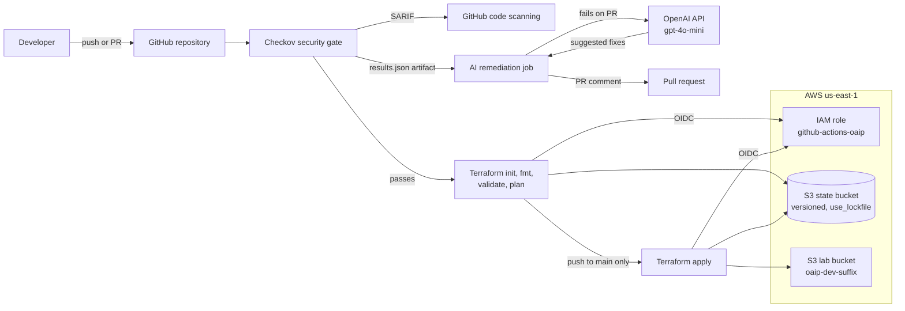

## Prerequisites

- An AWS account where I can create IAM roles and an OIDC identity provider
- AWS CLI v2, Terraform 1.10 or later (required for `use_lockfile`), Git, VS Code
- macOS with zsh (Homebrew for installing tools)
- An OpenAI API account with a small prepaid credit
- A GitHub account (a public repo makes code scanning free)

## Naming Conventions

| Resource | Name |
|---|---|
| GitHub repository | `clevelandjosiah/Open-Ai-Pipeline` |
| Terraform root folder | `terraform/foundation` |
| State bucket | `<openai-tfstate>` (created by hand, globally unique) |
| State key | `foundation/terraform.tfstate` |
| Lab bucket | `oaip-dev-<8-char hex suffix>` |
| IAM role | `github-actions-oaip` |
| OIDC provider | `token.actions.githubusercontent.com` |
| AI model | `gpt-4o-mini` (OpenAI API) |
| GitHub secrets | `AWS_ROLE_ARN`, `OPENAI_API_KEY` |
| Pipeline file | `.github/workflows/terraform.yml` |
| Region | US East (N. Virginia) (`us-east-1`) |

## Project Steps

### 1. Create the repository

```bash
mkdir Open-Ai-Pipeline && cd Open-Ai-Pipeline
git init -b main
git remote add origin https://github.com/clevelandjosiah/Open-Ai-Pipeline.git
```

The repo was created empty on GitHub first, with no README, `.gitignore`, or license, so the first push wouldn't conflict. I committed `.gitignore` before any Terraform file existed, so state files, plans, tfvars, and the `.terraform/` provider folder could never reach GitHub. `.terraform.lock.hcl` is deliberately not ignored, because it pins provider versions.

### 2. Bootstrap AWS and GitHub

Some things have to exist before Terraform or the pipeline can run: somewhere to keep state, an identity for the pipeline, its permissions, and the secrets the pipeline reads. I set these up once with the CLI, in three parts.

**State bucket.** Terraform can't store state in a bucket that doesn't exist yet:

```bash
aws sts get-caller-identity
aws s3api create-bucket --bucket <your-state-bucket> --region us-east-1
aws s3api put-bucket-versioning --bucket <your-state-bucket> \
  --versioning-configuration Status=Enabled
```

**OIDC provider and pipeline role.** AWS trusts tokens signed by GitHub, and the role's trust policy decides which repo gets in:

```bash
aws iam create-open-id-connect-provider \
  --url https://token.actions.githubusercontent.com \
  --client-id-list sts.amazonaws.com

cat > ~/trust.json << 'EOF'
{
  "Version": "2012-10-17",
  "Statement": [{
    "Effect": "Allow",
    "Principal": {
      "Federated": "arn:aws:iam::<ACCOUNT_ID>:oidc-provider/token.actions.githubusercontent.com"
    },
    "Action": "sts:AssumeRoleWithWebIdentity",
    "Condition": {
      "StringEquals": { "token.actions.githubusercontent.com:aud": "sts.amazonaws.com" },
      "StringLike": {
        "token.actions.githubusercontent.com:sub": [
          "repo:clevelandjosiah@<OWNER_ID>/Open-Ai-Pipeline@<REPO_ID>:*",
          "repo:clevelandjosiah/Open-Ai-Pipeline:*"
        ]
      }
    }
  }]
}
EOF

aws iam create-role --role-name github-actions-oaip \
  --assume-role-policy-document file://~/trust.json

aws iam attach-role-policy --role-name github-actions-oaip \
  --policy-arn arn:aws:iam::aws:policy/AmazonS3FullAccess
```

**GitHub secrets.** These are the only values the pipeline reads from GitHub:

```bash
gh secret set AWS_ROLE_ARN --body "arn:aws:iam::<ACCOUNT_ID>:role/github-actions-oaip"
gh secret set OPENAI_API_KEY
```

What it creates:

- **Remote state:** a versioned state bucket. New S3 buckets block public access and encrypt by default, and versioning means an earlier state file can always be recovered.
- **OIDC provider** for `token.actions.githubusercontent.com`, with `sts.amazonaws.com` as the audience. No AWS access key is ever created.
- **IAM role** `github-actions-oaip`, with a trust policy limited to this repo. GitHub sent this repo's `sub` claim with numeric owner and repo IDs (`owner@ownerId/repo@repoId`), so the policy accepts that format along with the name-only one:

| Trust condition | Value | Why |
|---|---|---|
| `aud` | `sts.amazonaws.com` | The token was requested for AWS |
| `sub` | `repo:clevelandjosiah@<OWNER_ID>/Open-Ai-Pipeline@<REPO_ID>:*` | The format GitHub actually sends for this repo |
| `sub` | `repo:clevelandjosiah/Open-Ai-Pipeline:*` | The older name-only format |

- **Permissions:**

| Principal | Policy | Scope |
|---|---|---|
| Pipeline role | `AmazonS3FullAccess` | All S3 in the account (to be scoped down to the two buckets) |

- **GitHub config:** repo secrets `AWS_ROLE_ARN`, which is an identifier rather than a credential, and `OPENAI_API_KEY`.

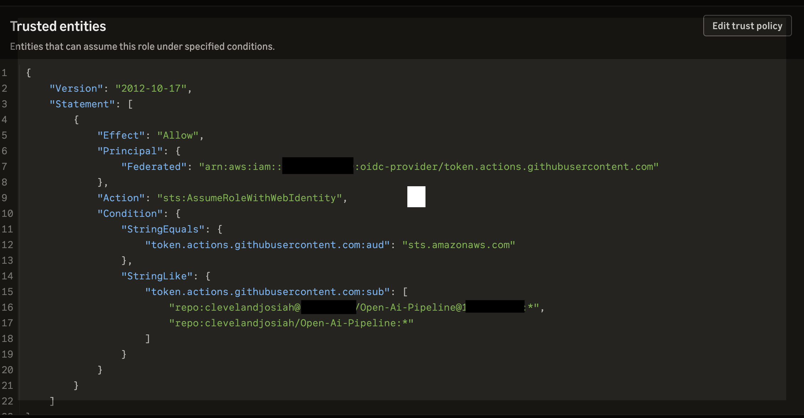

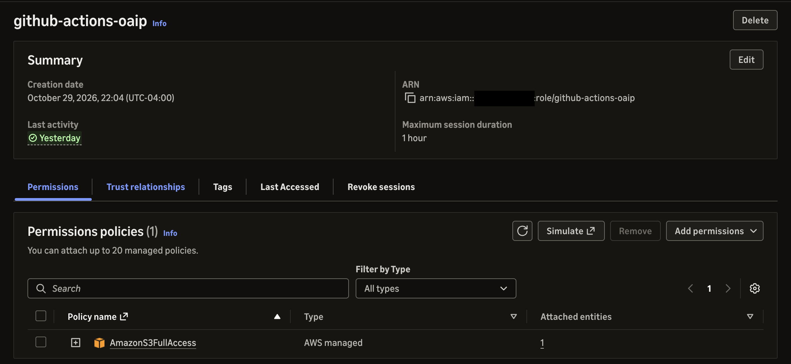

### 3. Terraform configuration

The configuration lives in [`terraform/foundation/`](terraform/foundation/). A few decisions worth calling out:

```hcl
terraform {
  backend "s3" {
    bucket       = "<your-state-bucket>"
    key          = "foundation/terraform.tfstate"
    region       = "us-east-1"
    encrypt      = true
    use_lockfile = true
  }
}
```

`use_lockfile` uses native S3 locking, so no DynamoDB table is needed. It requires Terraform 1.10 or later, which is why `required_version` is `>= 1.10.0`.

```hcl
provider "aws" {
  region = var.region
  default_tags { tags = var.tags }
}
```

`default_tags` applies `Environment`, `ManagedBy`, and `Project` tags to every resource without repeating them on each one.

```hcl
resource "aws_s3_bucket" "lab" {
  bucket = "${var.prefix}-${var.environment}-${random_id.suffix.hex}"
}

# INTENTIONAL VULNERABILITY for the security gate
resource "aws_s3_bucket_public_access_block" "lab" {
  bucket                  = aws_s3_bucket.lab.id
  block_public_acls       = false
  block_public_policy     = false
  ignore_public_acls      = false
  restrict_public_buckets = false
}
```

The `random_id` suffix keeps the bucket name globally unique. The public access block is turned off on purpose, so the gate has something real to catch.

### 4. Initialize locally and commit the lock file

```bash
cd terraform/foundation
terraform init
terraform fmt
terraform validate
terraform plan -out=tfplan
terraform apply tfplan
terraform output
terraform state list
cd ../..
git add terraform
git commit -m "feat: add foundation terraform with S3 backend"
git push
```

`terraform init` printed "Successfully configured the backend "s3"!", and the state file appeared in the state bucket. Before the pipeline existed, I applied once locally to confirm the backend and providers worked. The plan created 3 resources: `random_id`, `aws_s3_bucket`, and the public access block. From here on, the pipeline owns every apply.

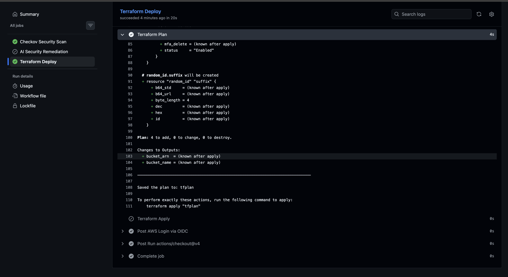

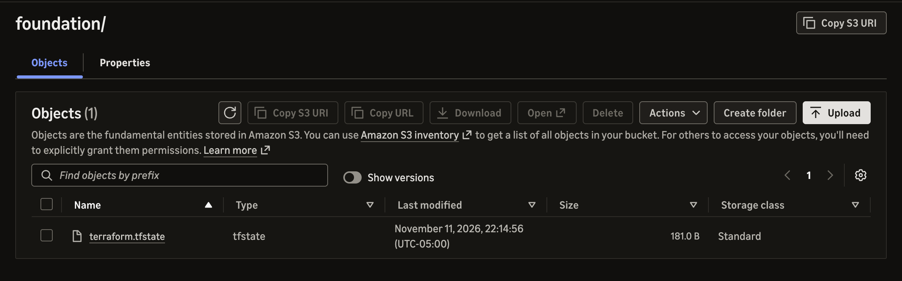

### 5. The security gate

Checkov runs with no `soft_fail`, so any failed check fails the scan job, and the deploy job (`needs: [scan]`) never starts. It produces three outputs in a single run: readable text in the log, SARIF for code scanning, and JSON for the AI job.

```yaml
- name: Run Checkov
  uses: bridgecrewio/checkov-action@v12
  with:
    directory: ${{ env.WORKING_DIR }}
    framework: terraform
    output_format: cli,sarif,json
    output_file_path: console,results.sarif,results.json
```

On the lab bucket it reported 11 findings:

| Check | What it wants | Status |
|---|---|---|
| CKV_AWS_53, CKV_AWS_54, CKV_AWS_55, CKV_AWS_56 | The four public access block settings enabled | Intentional vulnerability, fix pending |
| CKV_AWS_21 | Versioning on the bucket | Open |
| CKV_AWS_145 | KMS encryption by default | Open |
| CKV_AWS_18 | Access logging | Open |
| CKV2_AWS_61 | A lifecycle configuration | Open |
| CKV2_AWS_62 | Event notifications | Open, likely a documented skip for a lab bucket |
| CKV_AWS_144 | Cross-region replication | Open, likely a documented skip for a lab bucket |
| CKV2_AWS_6 | A public access block resource | Open |

### 6. The pipeline

[`.github/workflows/terraform.yml`](.github/workflows/terraform.yml) has three jobs:

| Job | Runs when | What it does |
|---|---|---|
| `Checkov Security Scan` | Every push to `main`, every PR, and manual runs | Blocking scan. Uploads SARIF to code scanning and saves JSON as an artifact for the AI job. |
| `AI Security Remediation` | Scan **fails** on a PR | Downloads the JSON, asks OpenAI (`gpt-4o-mini`) for a fix per unique check (up to 5), posts one PR comment |
| `Terraform Deploy` | Scan **passes** | Signs in with OIDC, then `init`, `fmt -check`, `validate`, `plan -out=tfplan`. Runs `apply` on that saved plan only on a push to `main`. |

Each job runs on its own fresh runner, which is why the Checkov results are passed to the AI job as an artifact instead of a file on disk.

The workflow-level `permissions` block is explicit, so anything not listed is denied:

```yaml
permissions:
  contents: read           # check out the code
  pull-requests: write     # post the AI comment
  security-events: write   # upload SARIF
  id-token: write          # request the OIDC token for AWS
```

#### The AI remediation script

[`scripts/remediate_ai.py`](scripts/remediate_ai.py) runs in the `AI Security Remediation` job. It reads the API key, the GitHub token, and the PR number from environment variables, so nothing sensitive is in the code. What it does, in order:

1. **Reads the real scan results** from `results.json`, the artifact the scan job uploaded.
2. **De-duplicates findings** by check ID, so each Checkov rule gets one AI call.
3. **Asks the model for a fix** for up to 5 findings, sending the check ID, the resource, the file, and Checkov's guideline.
4. **Rate-limits** with a one-second pause between calls.
5. **Posts one PR comment** with each finding, a suggested HCL fix, and why it matters, plus a count of any findings past the first 5.

```python
from openai import OpenAI

client = OpenAI()  # reads OPENAI_API_KEY from the environment

def get_ai_fix(check_id, resource, file_path, guideline):
    prompt = (
        f"Checkov check {check_id} failed on resource '{resource}' in {file_path}.\n"
        f"Guideline: {guideline}\n\n"
        "Give a concise Terraform HCL fix for AWS. Format:\n"
        "**Issue:** <one line>\n**Fix:**\n<corrected block>\n"
        "**Why this matters:** <one sentence>"
    )
    try:
        resp = client.chat.completions.create(
            model=model,
            messages=[
                {"role": "system", "content": "You are a DevSecOps engineer specializing in Terraform and AWS security. Be concise."},
                {"role": "user", "content": prompt},
            ],
            max_tokens=600,
            temperature=0.1,
            timeout=30,
        )
        return resp.choices[0].message.content
    except Exception as e:
        print(f"OpenAI error for {check_id}: {e}")
        return None
```

`temperature=0.1` keeps the suggestions consistent between runs. A failed call returns `None` instead of crashing, so one bad finding doesn't stop the rest. The comment is posted through GitHub's REST API (`POST /repos/{repo}/issues/{pr_number}/comments`) with the job's `GITHUB_TOKEN`, so each run adds a new comment rather than updating an earlier one.

The job only suggests fixes. It never edits code or commits, and the workflow doesn't grant `contents: write`, so it couldn't if it tried.

### 7. First deploy

> **Pending.** The pipeline's first deploy runs once the scan passes. This section will cover the first push to `main` that runs scan → plan → apply, with screenshots of the run and the deployed resources.

<!--  -->
<!-- 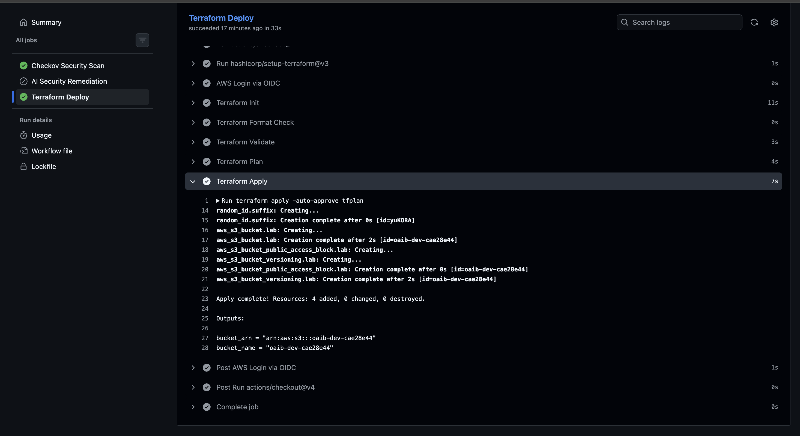 -->
<!--  -->
<!-- 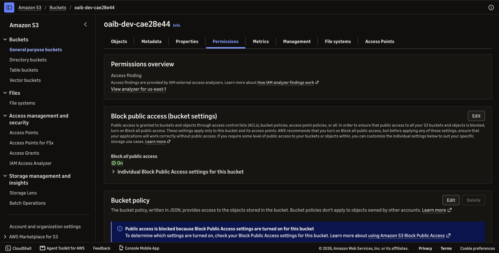 -->

### 8. Branch protection

> **Pending.** This ruleset gets applied once the scan passes. Until then, PRs with failing checks can still be merged, which is how PR #1 was merged. Turning it on earlier would block every merge, README changes included.

With the job names registered by the first runs, `main` requires a pull request, a passing `Checkov Security Scan`, and no force pushes:

```bash
cat > /tmp/ruleset.json << 'EOF'
{
  "name": "protect-main",
  "target": "branch",
  "enforcement": "active",
  "conditions": {
    "ref_name": { "include": ["~DEFAULT_BRANCH"], "exclude": [] }
  },
  "rules": [
    {
      "type": "pull_request",
      "parameters": {
        "required_approving_review_count": 0,
        "dismiss_stale_reviews_on_push": false,
        "require_code_owner_review": false,
        "require_last_push_approval": false,
        "required_review_thread_resolution": false
      }
    },
    {
      "type": "required_status_checks",
      "parameters": {
        "strict_required_status_checks_policy": true,
        "required_status_checks": [{ "context": "Checkov Security Scan" }]
      }
    },
    { "type": "non_fast_forward" }
  ]
}
EOF
gh api --method POST repos/clevelandjosiah/Open-Ai-Pipeline/rulesets --input /tmp/ruleset.json
rm /tmp/ruleset.json
```

| Rule | What it does |
|---|---|
| `pull_request` | Changes reach `main` only through a PR. Zero approvals are required, since I'm the only contributor. |
| `required_status_checks` | `Checkov Security Scan` must pass, and the branch must be up to date with `main` (`strict`) |
| `non_fast_forward` | Blocks force pushes that would rewrite `main`'s history |

`Terraform Deploy` isn't a required check on purpose. When the scan fails, deploy is skipped, and GitHub treats a skipped required check as passing, so requiring it would add nothing.

<!-- Screenshot: ruleset on main -->
<!-- Screenshot: PR merge blocked by the failing scan -->

Rulesets enforce on public repos with GitHub Free, which is another reason this repo is public.

### 9. Break and fix: watching the gate work

I pushed the pipeline on a feature branch and opened PR #1:

```bash
git checkout -b feature/add-pipeline
git add .github scripts requirements.txt
git commit -m "ci: add terraform pipeline with checkov gate and ai remediation"
git push -u origin feature/add-pipeline
```

What happened:

1. **The OIDC login failed first.** Every attempt returned `Not authorized to perform sts:AssumeRoleWithWebIdentity`. The OIDC provider, audience, trust policy, repo name, and secret all checked out. CloudTrail showed the real `sub` GitHub sent, which included numeric owner and repo IDs. Updating the trust policy to accept that format fixed it.
2. **The gate failed with 11 findings,** and `Terraform Deploy` was skipped, as designed.
3. **The findings appeared in code scanning** under the Security tab.
4. **The first AI comment was empty.** The AI step originally called Amazon Bedrock, and the comment showed only the header and "...and 6 more." Every call had failed, and the script skipped failed findings without failing the step. The job log showed the account had zero Bedrock quota, and AWS denied the increase, so I switched the AI step to the OpenAI API.
5. **After switching to OpenAI, the comment had real suggestions.** The public access block fix was correct: all four settings set to `true`.
6. **It also had two problems.** Findings 1 to 4 were the same fix repeated, because Checkov has a separate rule for each of the four settings, and the script sends each one separately. And the suggestion for CKV2_AWS_61 was wrong: it described logging, not lifecycle, in outdated syntax. The script only sent the check ID, so the model guessed what the check meant. That's exactly why the pipeline posts suggestions as comments for a human to review instead of committing them.

The remaining fixes, including applying the public access block correction and documenting skips for the checks that don't fit a lab bucket, are next.

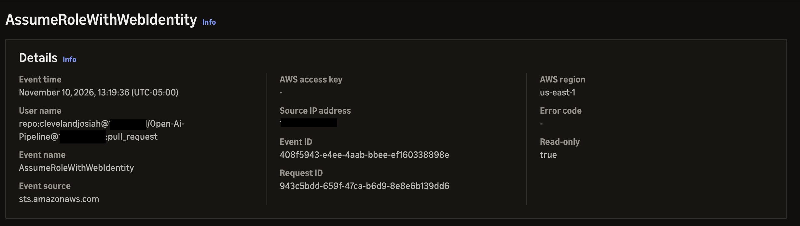

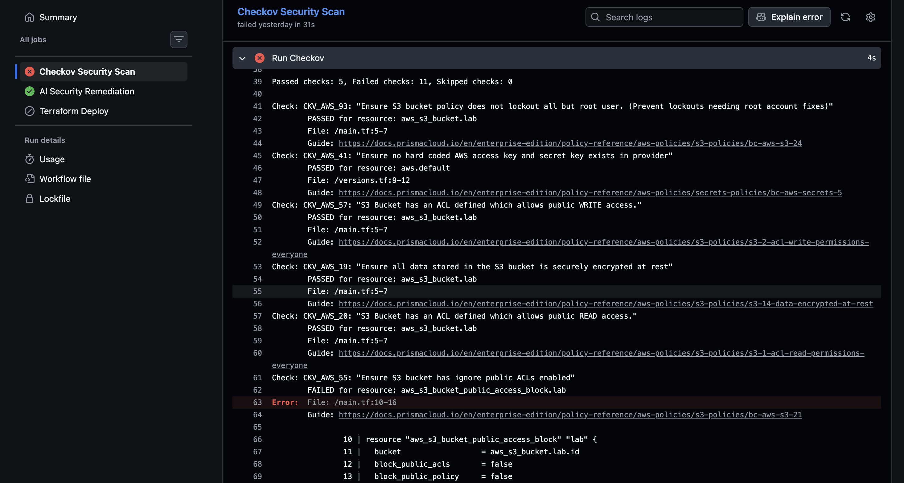

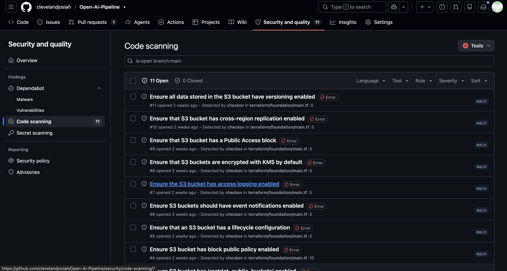


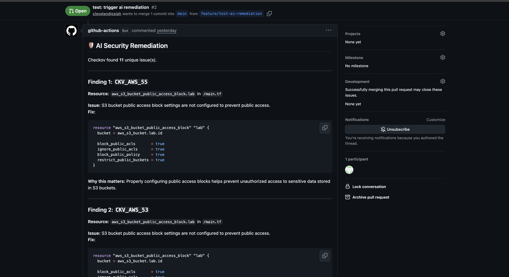

## Verification Checklist

- [x] The OIDC provider exists with `sts.amazonaws.com` as the audience
- [x] The role's trust policy accepts only this repo's tokens, including the ID-based `sub` format
- [x] State is stored in a versioned S3 bucket with `use_lockfile`
- [x] `.terraform.lock.hcl` is committed
- [x] A PR with findings fails the scan, and `Terraform Deploy` is skipped
- [x] Checkov SARIF results appear in the Security tab under code scanning
- [x] The AI remediation job posts a comment with suggested fixes on a failing PR
- [ ] The public access block fix is applied, and the remaining findings are fixed or skipped with a documented reason
- [ ] The scan passes and `terraform plan` runs in the pipeline
- [ ] A push to `main` runs scan → plan → apply
- [ ] Branch protection requires the scan to pass before merging
- [ ] The IAM role uses a least-privilege policy instead of `AmazonS3FullAccess`

## Troubleshooting

| Issue | Cause | Fix |
|---|---|---|
| OIDC login failed with `Not authorized to perform sts:AssumeRoleWithWebIdentity` | GitHub sent the `sub` claim with numeric IDs (`clevelandjosiah@<id>/Open-Ai-Pipeline@<id>`), but the trust policy expected the name-only format | Found the real `sub` in CloudTrail, and added it to the trust policy as a list |
| Bedrock returned `ThrottlingException: Too many tokens per day` | Every on-demand Bedrock quota for the account was 0 | Filed an AWS Support case; when it was denied, switched to the OpenAI API |
| The AI comment posted with only a header and "...and 6 more" | Every AI call failed, and the script skipped failed findings without failing the step | Read the job log to find the real error |
| The AI repeated the same fix four times | Checkov has a separate check for each public access block setting, and the script sends each one | Planned: group findings by resource |
| The AI suggested a logging fix for CKV2_AWS_61 | The script only sent the check ID, so the model guessed what it meant | Planned: send Checkov's `check_name` in the prompt |
| `git push` failed with `'origin' does not appear to be a git repository` | The remote had been added as `orgin` | `git remote rename orgin origin` |
| `git add` failed with `pathspec 'requirements.txt' did not match any files` | The file hadn't been created yet, so nothing was staged | Created the file, then reran `git add` |
| `terraform init` said it was initialized in an empty directory | It ran from `terraform/` instead of `terraform/foundation/` | `cd foundation`, then reran init |
| `gh: command not found` after `pip3 install gh` | The pip package named `gh` is unrelated to the GitHub CLI | Uninstalled it, and used `brew install gh` or the GitHub website |
| `code: command not found` | The VS Code shell command wasn't on the PATH | VS Code → Cmd+Shift+P → *Shell Command: Install 'code' command in PATH* |
| `Set-Alias: command not found` | `Set-Alias` is PowerShell, and the Mac terminal runs zsh | `alias tf='terraform'` in `~/.zshrc` |
| The `.gitignore` exception for `terraform.tfvars.example` didn't work | An inline comment on the `!` line became part of the pattern | Moved the comment onto its own line |

## Cleanup

```bash
cd terraform/foundation
terraform destroy
cd ../..

# The state bucket is versioned: empty it in the S3 console (which removes all versions), then delete it
aws s3api delete-bucket --bucket <your-state-bucket> --region us-east-1

aws iam detach-role-policy --role-name github-actions-oaip \
  --policy-arn arn:aws:iam::aws:policy/AmazonS3FullAccess
aws iam delete-role-policy --role-name github-actions-oaip --policy-name bedrock-invoke
aws iam delete-role --role-name github-actions-oaip
aws iam delete-open-id-connect-provider \
  --open-id-connect-provider-arn arn:aws:iam::<ACCOUNT_ID>:oidc-provider/token.actions.githubusercontent.com
```

Skip the `bedrock-invoke` line if that policy was already removed. Revoke the OpenAI API key in the OpenAI dashboard. The `AWS_ROLE_ARN` secret can stay, since it points at a deleted role and grants nothing.

## Key Takeaways

- **OIDC removes the AWS keys, but the subject claim is strict.** The trust policy has to match the exact `sub` GitHub sends, and new repos embed numeric owner and repo IDs in it. CloudTrail showed the exact value in one lookup.
- **Trusting GitHub as an identity provider isn't the security boundary.** Any GitHub workflow can get a valid token. The `sub` condition is what limits the role to this repo.
- **Check AI quota before designing around a provider.** A new AWS account had zero Bedrock quota, and new Azure subscriptions often start the same way.
- **A security gate is only real if it can fail.** With no `soft_fail`, the deploy job can't run until every finding is fixed or skipped with a written reason.
- **Pipelines should fail loudly.** The first AI comment looked successful but was empty, because the script swallowed every error.
- **AI suggestions need context and a reviewer.** With only a check ID, the model guessed wrong. It comments rather than commits for exactly that reason.
- **Names have to match exactly.** Remote names, the repo name in the trust policy, and the bucket name in `backend.tf` are all exact matches.

---

Built by **Anthony Cleveland** · Cloud Engineer · [github.com/clevelandjosiah](https://github.com/clevelandjosiah)
